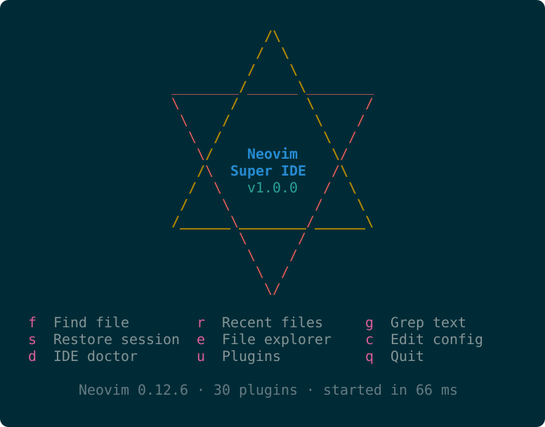

<p align="center">
  
</p>

# Neovim Super IDE

**One file**, `init.lua`, that turns Neovim into a keyboard-first IDE — and
installs, updates, moves and removes itself, on Linux, macOS and Windows alike.

- **One command to install.** No Neovim needed beforehand: the script adds
  missing system packages, fetches the pinned Neovim and installs the IDE (§1).
- **One file, every platform.** Run as a script (`nvim -l init.lua install`),
  `init.lua` is the installer; loaded as a configuration, it is the IDE. The two
  scripts only prepare a machine for the first start.
- **Reproducible.** The `LOCK` table in the file pins Neovim, every plugin and
  every language tool: the same file installs the same IDE on any machine.
- **Generations.** `:IDEPin` stores each approved state as a complete copy of
  the file. `:IDEUpdate` tries newer versions, `:IDERollback` and `:IDESwitch`
  go back, `:IDEExport` moves a generation to another machine.
- **Bring your own compiler.** Language servers, formatters, Tree-sitter parsers
  and debuggers download the first time you open a file of that language.
- **No footprints.** Super IDE runs its own Neovim from your home directory.
  Your previous configuration is kept as `nvim-orig` and still runs;
  uninstalling restores it.
- **No silent `sudo`.** A missing system package is installed only after you
  approve the exact command.
- **Old habits are honoured.** `,` is the leader, `<C-]>` jumps to definitions,
  `<F5>` debugs, `<F6>` runs.

| File | Purpose |
|:-----|:--------|
| `init.lua` | The IDE and its own installer, uninstaller and version manager |
| `install.sh` | First-time setup on Linux and macOS: system packages, pinned Neovim, then `init.lua install` |
| `install.ps1` | The same for Windows 10 / 11 |
| `README.md` | This guide |
| `LICENSE` | MIT license (§14) |
| `assets/` | `logo.svg` (the start screen as the project logo) and `gen_logo.py`, which generates it |

Keep the scripts next to `init.lua`: they install the one beside them.

---

## 1. Install

**Straight from the repository** — no files needed:

```sh
# Ubuntu / Debian (also WSL), macOS
curl -fsSL https://raw.githubusercontent.com/smartcub/nvim-super-ide/main/install.sh | sh
```

```powershell
# Windows 10 / 11, in a PowerShell window
irm https://raw.githubusercontent.com/smartcub/nvim-super-ide/main/install.ps1 | iex
```

The script downloads `init.lua` and both scripts to a temporary directory and
installs from there.

**From local files** (an export, a download, a clone), in their folder:

| System | Command |
|:--|:--|
| Ubuntu / Debian (also WSL), macOS | `sh install.sh` |
| Windows 10 / 11 | `powershell -ExecutionPolicy Bypass -File install.ps1` |

Options:

- `--yes`: accept every default (required without a terminal, e.g. in CI).
- `--git-editor`: make git open commit messages in Super IDE.

With the one-liners, pass options after `sh -s --` (`… | sh -s -- --yes`); on
Windows use `& ([scriptblock]::Create((irm <URL>))) --yes`, because `irm | iex`
cannot pass arguments. `-ExecutionPolicy Bypass` applies to that run only. To
install from a fork or mirror, set `SUPER_IDE_REPO` (`owner/repo`) or
`SUPER_IDE_BASE` (full base URL).

Then **open a new terminal** and run `nvim`. `:IDEDoctor` reports what is
installed and what is missing.

### Network access

Installation and later use (language tools on first use, `:IDEUpdate`) download
from GitHub. In regions where access to GitHub is restricted, arrange reliable
access yourself before installing; otherwise the first download fails, typically
with `curl: (35) OpenSSL SSL_connect: SSL_ERROR_SYSCALL in connection to github.com:443`.

**Supported:** Ubuntu 22.04 / 24.04 and Debian (`apt-get`), macOS (Apple
silicon or Intel), Windows 10 1803+ and 11 (`winget`); x86_64 and arm64. Other
Linux distributions work, but you install the packages yourself: the script
lists what is missing (§2) and stops only for required ones.

### What the script does

0. Without `init.lua` beside it (piped from `curl` or `irm`): downloads the
   three files from the repository.
1. Reads the Neovim version pinned in the `LOCK` (currently **v0.12.6**).
2. Installs missing system packages (§2): shows the exact command (`apt-get`,
   `xcode-select --install` or `winget install`) and runs it only with your
   consent. It never upgrades the whole system.
3. Downloads that Neovim release to a temporary directory, unless Super IDE
   already has it.
4. Runs it as the installer, `nvim -l init.lua install` (below), reusing the
   downloaded archive.
5. Removes the temporary directory.

The script can be re-run safely.

### What `init.lua install` does

1. Checks the system, CPU and required packages (§2).
2. If Super IDE is already installed, **imports** the file as a new generation
   (§3) and stops.
3. Unpacks the pinned Neovim into `~/.local/opt/super-ide/nvim-<version>`
   (Windows: `%LOCALAPPDATA%\super-ide`), testing it before moving it into place.
4. Renames your existing Neovim directories to `nvim-orig` (§5).
5. Offers to restore the state kept by an earlier uninstall, if any.
6. Copies `init.lua` to `~/.config/nvim`, stores it as the first generation and
   writes the plugin lock file. The scripts are kept for `:IDEExport`.
7. Makes the `nvim` command start the pinned Neovim:
   - **Linux / macOS**: the link `~/.local/bin/nvim`. On Ubuntu, `~/.profile`
     adds `~/.local/bin` to `PATH` at login (log in again if it is new). On
     macOS the installer offers to add a marked line to `~/.zprofile`.
   - **Windows**: an entry in the user `PATH`. The *system* `PATH` is searched
     first, so a system-wide Neovim (winget's default) still wins; the installer
     warns about it. Remove it (`winget uninstall Neovim.Neovim`) or start
     Super IDE by its full path.
8. Runs the pinned Neovim headless to install the pinned plugins and tools and
   the languages listed in the `LOCK`.

With Neovim **0.12+** already present, `nvim -l init.lua install` can be run
directly. It does the same, except that on macOS it only starts Apple's
installer for missing packages.

### Cancelling

Press **Ctrl+C** at any time to cancel the installation; every change it made
is reverted. An error is handled the same way. The message
`Nvim: Caught deadly signal 'SIGINT'` that Neovim prints first is expected.
System packages installed during the run are kept. Cancelling an import
restores the previous generation, which may take a few minutes.

> Install a Nerd Font (e.g. **MesloLGS NF**) on the machine that runs your
> terminal; over SSH that is your local machine.

---

## 2. What the machine needs

The scripts install these. The table is for reference and for other Linux
distributions.

| Package | What it is for | Without it |
|:--|:--|:--|
| git | Plugins; listing Neovim releases | Cannot install |
| curl | Neovim, tools, runtimes | Cannot install |
| tar, unzip | Unpacking downloads (Windows ships tar, which also reads zip) | Cannot install / Mason cannot unpack zip releases |
| A C compiler | Building Tree-sitter parsers | Only basic regex highlighting |
| python3 with venv | Mason installs Python-based tools (basedpyright, debugpy, clang-format, the jdtls launcher) into private virtual environments | Python, Java and clang-format tooling cannot install. **Stock Ubuntu lacks `python3-venv`** |
| wl-clipboard or xclip | System clipboard in a graphical Linux session | No `"+` clipboard (OSC 52 still works over SSH) |

| System | What the script runs |
|:--|:--|
| Ubuntu / Debian | `sudo apt-get install -y` the missing ones of: `git curl tar unzip build-essential python3 python3-venv`, plus `wl-clipboard` or `xclip` in a graphical session |
| macOS | `xcode-select --install` (git, clang, python3); curl, tar and unzip are part of macOS. Homebrew is not needed |
| Windows | `winget install -e --id` `Git.Git`, `LLVM.LLVM` (clang) and `Python.Python.3.12`. LLVM leaves clang off `PATH`; Super IDE finds it in `C:\Program Files\LLVM\bin` by itself. Python must be on `PATH` (the installer's "Add Python to environment variables") |

If *unattended-upgrades* holds the package lock (common on a fresh Ubuntu), the
script waits up to 10 minutes.

Neovim is the official release from <https://github.com/neovim/neovim/releases>.
On Linux it needs a recent glibc; on older systems it fails with
"GLIBC_2.xx not found". The distribution package is not used (Ubuntu 24.04 ships
0.9.5, which is too old).

### Optional: the toolchains you write code with

Not installed automatically, since the version depends on your project:

| Language | Install it yourself (Ubuntu) |
|:--|:--|
| Go | `sudo apt install golang` or the tarball from go.dev |
| Rust | `curl https://sh.rustup.rs -sSf \| sh`, then `rustup component add rustfmt` |
| PHP | `sudo apt install php-cli` |
| Java (for your projects) | `sudo apt install openjdk-21-jdk` (jdtls gets its own JDK regardless) |
| Assembly (asm-lsp) | Built with Cargo, so Rust as above |

**Node.js and JDK 21 are not needed**: Super IDE downloads private portable
builds when a language server requires them.

**Network access** used by the IDE: `github.com` (Neovim, plugins, Mason
packages, parsers), `api.github.com` (Mason's registry), `nodejs.org`,
`api.adoptium.net` (JDK), `pypi.org` / `files.pythonhosted.org`,
`registry.npmjs.org`, and your distribution's package mirror. Mirrors are
configured in `SETTINGS` (§10).

---

## 3. Generations: update, pin, roll back, switch, move

A **generation** is a complete `init.lua`: code plus a `LOCK` naming the Neovim
version, plugin commits, tool versions and languages. Generations are stored in
`~/.local/share/nvim/super-ide/generations/`, named by date and Neovim version.
One is in effect; the others are re-installed on demand.

The live state is one of:

| State | Meaning | Reached by |
|:--|:--|:--|
| **pinned** | Everything matches the generation in effect | Install, `:IDEPin`, `:IDERollback`, `:IDESwitch` |
| **unpinned changes** | You edited `init.lua`, ran `:Lazy update`, upgraded a tool in `:Mason`, or opened a new language whose tools are not in the `LOCK` yet | Using the IDE |
| **candidate** | Something newer is being tried | `:IDEUpdate` |

| Command | What it does |
|:--|:--|
| `:IDEUpdate` | Make a **candidate**: the newest Neovim, plugins and tools. The new Neovim is unpacked next to the current one; restart to try it |
| `:IDEUpdate v0.12.5` | Change **only Neovim** to that release (Tab completes the releases ≥ 0.12); plugins and tools stay as pinned. Crossing a minor version asks first |
| `:IDEPin` | Approve the live state: write it into the `LOCK` of `init.lua`, store the file as a new generation, remove the Neovim builds no longer used |
| `:IDERollback` | Drop the candidate or the unpinned changes; return to the generation in effect. An edited `init.lua` is first set aside in `super-ide/rejected/` |
| `:IDESwitch <generation>` | Go to any stored generation (Tab lists them, newest first): its Neovim, its `init.lua`, its plugins, tools and parsers |
| `:IDEExport [dir] [--history]` | Write the generation in effect to `dir/init.lua` (with `--history`, every stored generation too) |

`:IDEDoctor` shows the state and why, the generation in effect, and recent
history (`records/history.tsv`).

- **Only pinned generations are exported.** `:IDEExport` skips a candidate or
  unpinned edits and says so; `:IDEPin` first to include them.
- **Code and versions switch together.** A switch replaces `init.lua` and
  checks out that generation's Neovim, plugins and tools, then rebuilds the
  parsers, so any two stored generations can be switched safely.
- To return to a Neovim proven earlier, use `:IDESwitch`; `:IDEUpdate <version>`
  is for untested combinations.

### Moving to another machine

```
lab:   :IDEExport /media/usb
home:  sh /media/usb/install.sh          (Windows: install.ps1)
```

The export writes `init.lua` and the two scripts, so the target needs no Neovim.
(If Super IDE was installed without the scripts, only `init.lua` is written;
copy the scripts next to it, or run `nvim -l init.lua install` with Neovim 0.12+.)

On a machine without Super IDE this is a fresh install; otherwise the file is
imported as a new generation (with a `generations/` folder from `--history`, if
present). Either way the target gets the same Neovim, plugins and tools.

---

## 4. How the IDE provisions itself

Languages are described by **one table**, `LANGS` (section 8 of `init.lua`).
When a buffer gets a filetype, the IDE looks up its row and, in the background:

1. starts Tree-sitter highlighting if the parser is present, else builds it;
2. checks each tool on `PATH` — **a tool you installed yourself always wins**;
3. installs the missing ones through **Mason**, at the version in the `LOCK`
   when it names one (the latest otherwise, pinned by your next `:IDEPin`);
4. enables the language server as soon as its binary exists (it does not wait
   for parsers).

The statusline shows `⟳ name` during downloads; later opens cost nothing.

| Layer | Examples | Who provides it |
|:--|:--|:--|
| ① The compiler or interpreter you write code with | gcc, python3, cargo, go, php, your project's JDK | **You** |
| ② IDE tooling | every LSP server, formatter, debug adapter, `tree-sitter` CLI | **Super IDE, automatically**, via Mason |
| ③ Runtimes the tooling needs | Node.js LTS (web language servers), JDK 21 (jdtls) | **Super IDE, automatically**: portable builds on `PATH` for Neovim only |
| ④ System packages | C compiler, `unzip`, `python3-venv` | **You, with one keypress**: the command is proposed and runs only if you agree |

The portable JDK is given to jdtls only (via its `JAVA_HOME`); your projects
keep their own JDK. `ripgrep`, `fd` and `fzf` are installed during setup if
missing.

**Debug adapters** (codelldb, debugpy, delve) download on the first `<F5>` in a
language. `debug = false` in `SETTINGS` disables debugging.

---

## 5. A green install, and a clean uninstall

### Where everything lives

| | Linux / macOS | Windows |
|:--|:--|:--|
| config (`init.lua` only) | `~/.config/nvim` | `%LOCALAPPDATA%\nvim` |
| data (plugins, Mason, parsers, runtimes, generations, records) | `~/.local/share/nvim` | `%LOCALAPPDATA%\nvim-data` |
| state (sessions, undo, shada) | `~/.local/state/nvim` | `%LOCALAPPDATA%\nvim-data` |
| cache | `~/.cache/nvim` | `%TEMP%\nvim` |
| Neovim builds | `~/.local/opt/super-ide/nvim-<version>`, `current` → the live one | `%LOCALAPPDATA%\super-ide\…` (a junction for `current`) |
| the `nvim` command | `~/.local/bin/nvim` → `current/bin/nvim` | user `PATH` entry `…\super-ide\current\bin` |

(`XDG_CONFIG_HOME` and friends are honoured, as Neovim honours them.)

Tool caches (npm, pip, wget, the tree-sitter CLI, clangd's system-header index)
are redirected into these directories. Go's module cache and Cargo's registry
stay with your toolchains.

### Your previous configuration: set aside, and still usable

On first install, existing Neovim directories are **renamed, never deleted**:

```
~/.config/nvim        ->  ~/.config/nvim-orig
~/.local/share/nvim   ->  ~/.local/share/nvim-orig
~/.local/state/nvim   ->  ~/.local/state/nvim-orig
~/.cache/nvim         ->  ~/.cache/nvim-orig
```

These are the directories of the application name `nvim-orig`, so the old
setup still runs:

```bash
NVIM_APPNAME=nvim-orig nvim     # your previous configuration, plugins and history
```

If both `nvim` and `nvim-orig` exist, the installer stops instead of
overwriting anything. A state directory containing only an empty `nvim.log` is
not considered yours.

### clangd's index stays out of your repository

clangd writes its index to `<project>/.cache/clangd`. The IDE makes
`<project>/.cache` a **symlink** (Windows: **junction**) into
`~/.cache/nvim/clangd-index/` and adds `/.cache` to `.git/info/exclude` (never
committed). An existing real `.cache` is left alone; every link and line is
recorded and undone on uninstall.

### Uninstalling

```vim
:IDEUninstall          " asks keep-or-delete; finishes after Neovim exits
```
```bash
nvim -l ~/.config/nvim/init.lua uninstall      # from a terminal
```

`--keep-state` / `--discard-state` answer the question in advance; `--yes`
keeps the state. The removal runs from a copy of `init.lua` in the system temp
folder, because a running Neovim cannot delete its own directories.

- **From a terminal** (Linux, macOS) it runs in the foreground.
- **From `:IDEUninstall`, and on Windows**, it runs in the background after
  Neovim exits (unsaved files must be written or discarded first). The log is
  `$TMPDIR/super-ide-uninstall-*/uninstall.log` (default `/tmp`; Windows:
  `%TEMP%\super-ide-uninstall-*\uninstall.log`), readable by you only and
  removed by the next uninstall.

Steps:

1. removes the clangd links and `.git/info/exclude` lines inside your projects;
2. restores git's `core.editor` (and removes a `~/.gitconfig` that existed only for it);
3. removes the `nvim` command: the link, the `~/.zprofile` line, or the user `PATH` entry;
4. **keeps or deletes Super IDE's state**:
   - **keep** (default): config, data and state (plugins, tools, generations,
     history) move to `~/.local/share/.super-ide-trash` (Windows:
     `%LOCALAPPDATA%\.super-ide-trash`); the next install offers to restore them.
   - **delete**: they are removed, together with any older trash.
5. renames `nvim-orig` back to `nvim`;
6. removes the Neovim builds and any now-empty directories the install created
   (`~/.local/bin`, `~/.cache`, …).

System packages are listed but kept. On Ubuntu 24.04.5, install followed by
uninstall (delete) leaves the home directory identical to before.

---

## 6. Daily use

```bash
nvim file.c                       # Neovim Super IDE
nvim --clean file.c               # stock Neovim: no configuration, no plugins
NVIM_APPNAME=nvim-orig nvim       # your previous configuration (if you had one)
```

### Opening commit messages in Neovim

Install with **`--git-editor`** (sets `git config --global core.editor nvim`;
restored on uninstall), or configure it yourself:

```bash
git config --global core.editor nvim     # git only
export EDITOR=nvim VISUAL=nvim           # in ~/.profile: crontab -e, sudoedit, …
```

### The start screen

`nvim` without a file shows an ASCII hexagram and a one-key menu:

```
  f  Find file        r  Recent files     g  Grep text
  s  Restore session  e  File explorer    c  Edit config
  d  IDE doctor       u  Plugins          q  Quit
```

### Clipboard

Locally, `unnamedplus` uses the system clipboard. **Over SSH**, copying uses
**OSC 52**, which places the text on your local clipboard; pasting uses an
internal cache. In tmux, set `set -g set-clipboard on`. Hold **Shift** while
dragging to use the terminal's own selection.

---

## 7. Languages

| Language | Server | Formatter | Debug | Needs (layer ①/③) |
|:--|:--|:--|:--|:--|
| C / C++ / CUDA | clangd | clang-format | codelldb | Python (for Mason's clang-format, if you have no system one) |
| Python | basedpyright | ruff (fix + format) | debugpy | Python 3 with venv |
| Rust | rust-analyzer | rustfmt (from rustup) | codelldb | — |
| Go | gopls | goimports → gofmt | delve | Go |
| Java | jdtls | via jdtls | — | JDK 21 (auto), Python 3 (jdtls launcher) |
| JavaScript / TypeScript | vtsls + eslint | prettier | — | Node.js (auto) |
| HTML / JSP | html + emmet | prettier | — | Node.js (auto) |
| CSS / SCSS / Less | cssls | prettier | — | Node.js (auto) |
| PHP | intelephense | php-cs-fixer | — | PHP, Node.js (auto) |
| Assembly | asm-lsp | — | — | Cargo |
| Lua | lua_ls | stylua | — | — |
| Shell | bashls (+ shellcheck) | shfmt | — | Node.js (auto) |
| JSON / YAML | jsonls / yamlls | prettier | — | Node.js (auto) |
| TOML | taplo | taplo | — | — |
| Markdown | marksman | prettier | — | Node.js (auto) |
| CMake | neocmake | via LSP | — | — |
| Dockerfile | dockerls | — | — | Node.js (auto) |
| XML | lemminx | via LSP | — | — |
| SQL | — | sql-formatter | — | Node.js (auto) |
| Make, Vim script | — | — | — | — (highlighting only) |

- **Indentation**: 2 spaces by default; Python, Rust, Java and PHP use 4; Go uses
  tabs; Makefiles use real tabs. A project's `.editorconfig` always wins.
- **intelephense**'s free tier covers completion, diagnostics and navigation;
  renaming and some refactors need a licence.
- **basedpyright** runs with `typeCheckingMode = "standard"`.

### Adding a language

Add one row to `LANGS` — nothing else. For example, Zig:

```lua
zig = {
  label = "Zig", ft = { "zig" }, ts = { "zig" },
  lsp = { "zls" },
  tools = { { bin = "zls", mason = "zls", server = "zls" } },
  format = {},                 -- zls formats through the LSP fallback
  indent = { width = 4 },
},
```

Open a Zig file, then `:IDEPin` to record the language and its tool versions in
the `LOCK`.

---

## 8. Keymaps

**Leader:** `,`

### Global (Normal mode)

| Key | Action |
|:--|:--|
| `-` | Oil (edit the parent directory as a buffer) |
| `<C-]>` | Go to definition (LSP, else tags) |
| `<C-h>` `<C-j>` `<C-k>` `<C-l>` | Window left / down / up / right |
| `<C-Left>`, `<C-Right>` | Window left / right (for terminals that eat `<C-h>`/`<C-l>`) |
| `<BS>` | Vim's own: one character back; the text is untouched |
| `<C-p>` | Find files |
| `<C-\>` | Toggle floating terminal |
| `<F2>` / `<F3>` | Previous / next buffer |
| `<F5>` | Debug: start or continue (fetches the adapter on first use) |
| `<F6>` | Run current file |
| `<F7>` | Run project (Cargo, Go module, CMake, Make, npm, Maven or Gradle; else the file) |
| `<F9>` | Toggle breakpoint |
| `<F10>` / `<F11>` / `<F12>` | Step over / into / out |
| `,,<Space>` | Clear search highlight |
| `,,ev` | Edit `init.lua` |
| `,cg` | Toggle column guides (80/100/120) |
| `,db` | Conditional breakpoint |
| `,dr` | Debug REPL |
| `,du` | Debug UI toggle |
| `,e` | File explorer (neo-tree; closes itself when a file is opened) |
| `,f` | Format buffer |
| `,fb` | Buffers |
| `,fc` | Toggle cursor cross (cursorline + cursorcolumn) |
| `,ff` | Find files |
| `,fh` | Help tags |
| `,fo` | Recent files |
| `,ig` | Toggle indent guides |
| `,nf` | Generate a file header comment (neogen) |
| `,ng` | Generate a doc comment for the symbol under the cursor (neogen) |
| `,o` | Outline (symbols) |
| `,ql` | Restore last session |
| `,qs` | Restore session for this directory |
| `,rg` | Live grep |
| `,tf` | Toggle format-on-save |
| `,u` | Undo tree (built into Neovim 0.12) |

### When a language server is attached

| Key | Action |
|:--|:--|
| `<C-]>` | Go to definition |
| `gr` | References |
| `gy` | Type definition (falls back to definition) |
| `gI` | Implementation (falls back to definition) |
| `K` | Hover documentation |
| `[g` / `]g` | Previous / next diagnostic (also `[d` / `]d`) |
| `gl` | Diagnostics of the current line |
| `,rn` | Rename symbol |
| `,ca` | Code action (Normal and Visual mode) |
| `,ch` | Switch between source and header (clangd) |

`gr`, `gy` and `gI` open a picker when there are several results and jump
straight there when there is one. `gi` is Vim's own (insert where you last left
Insert mode).

### Insert, terminal and completion

| Mode | Key | Action |
|:--|:--|:--|
| Insert | `<Left>` at column 1 | Move to the end of the previous line |
| Insert | `<Right>` at end of line | Move to the start of the next line |
| Insert | `<CR>` | Accept the selected completion item; with none selected, a plain newline |
| Insert | `<Tab>` / `<S-Tab>` | Next / previous item, or jump within a snippet |
| Insert | `<Up>` / `<Down>` | Previous / next item while the menu is open |
| Insert | `<C-Space>` | Open completion / toggle documentation |
| Insert | `<C-k>` | Toggle signature help |
| Insert | `filehdr` | Snippet: file header for C, C++ and assembly |
| Terminal | `<Esc>` | Back to Normal mode (inside the fuzzy finder, `<Esc>` closes it) |

---

## 9. Commands

| Command | Purpose |
|:--|:--|
| `:IDEDoctor` | Generation state and history; what is installed, where it came from (system / Mason / sandbox), and what is missing — with the command to fix it |
| `:IDEInstall [lang… \| all]` | Provision languages now (no argument: the current buffer's language) |
| `:IDEPrewarm [dir]` | Scan a directory and provision every language found in it |
| `:IDEUpdate [vX.Y.Z]` | Try newer Neovim, plugins and tools as a candidate — or only another Neovim (§3) |
| `:IDEPin` | Record the live state as a new generation |
| `:IDERollback` | Return to the generation in effect |
| `:IDESwitch <generation>` | Switch to a stored generation |
| `:IDEExport [dir] [--history]` | Export the generation in effect |
| `:IDEAdd <owner/repo \| git URL>` | Declare and install a new plugin (§12); `:IDEPin` locks it after you have tried it |
| `:IDESync` | Bring plugins, tools (including `rg`, `fd`, `fzf`) and parsers in line with the `LOCK` (run for you after install and switches) |
| `:IDEUninstall` | Remove Super IDE; keep its state in the trash or delete it |
| `:ColumnGuidesToggle` / `On` / `Off` | Column guides |
| `:LspInfo` | Alias for `:checkhealth vim.lsp` |
| `:Mason`, `:Lazy` | Package and plugin managers |

From a terminal: `nvim -l init.lua install`, `nvim -l ~/.config/nvim/init.lua
uninstall`, `nvim -l init.lua help`.

---

## 10. Settings

The `SETTINGS` table near the top of `init.lua`:

| Setting | Default | Meaning |
|:--|:--|:--|
| `leader` | `","` | Leader key |
| `format_on_save` | `true` | Initial state; toggle at runtime with `,tf` |
| `debug` | `true` | Include debugging; adapters still download only on first `<F5>` |
| `auto_install` | `true` | Fetch tooling on first sight of a language |
| `python_provider` | `false` | Enable only for legacy remote plugins that need pynvim |
| `ui2` | `false` | Neovim 0.12's experimental message UI (removes "Press ENTER" prompts) |
| `github` | `https://github.com` | Mirror prefix for plugins, Mason downloads and portable tools |
| `neovim_releases` | `https://github.com/neovim/neovim/releases/download` | Where Neovim builds are downloaded from |
| `node_dist` | `https://nodejs.org/dist` | Mirror for the portable Node.js |
| `adoptium_api` | `https://api.adoptium.net` | Source of the portable JDK 21 |

Changing a setting counts as an *unpinned change* until `:IDEPin`. Do not edit
the `LOCK` table by hand; `:IDEPin` writes it.

---

## 11. Troubleshooting

Start with **`:IDEDoctor`**. Then:

| Symptom | Cause and fix |
|:--|:--|
| `nvim` still starts another Neovim after installing | Open a new terminal (or `hash -r`). Linux: log in again if `~/.local/bin` was new. Windows: a system-wide Neovim comes first on `PATH`; remove it (§1) |
| `install.ps1` "cannot be loaded because running scripts is disabled" | Start it with `powershell -ExecutionPolicy Bypass -File install.ps1` (§1) |
| An install printed `Nvim: Caught deadly signal 'SIGINT'` | Expected after Ctrl+C; the install was reverted (§1, Cancelling) |
| `curl: (35) … SSL_ERROR_SYSCALL in connection to github.com:443`, or downloads that hang | GitHub cannot be reached from this network (§1, Network access) |
| `install.sh` says "no terminal to ask on" | It runs without a terminal (CI, cron): add `--yes` |
| The Neovim download fails with "GLIBC_2.xx not found" | This Linux is older than the official builds support; Ubuntu 22.04 or newer works |
| `:IDEPin` says to restart first | A candidate's Neovim is in place but not yet running; restart, try it, then pin |
| `:IDEExport` warns about unpinned changes | It exported the last pinned generation; `:IDEPin` first if the changes should travel |
| A language says “partly ready” | `:IDEDoctor` lists each problem under that language. Fix it, then `:IDEInstall <lang>` |
| Python never gets a language server | `python3-venv` is missing: `sudo apt install python3-venv`, then `:IDEInstall python` |
| “the Mason registry could not be downloaded” | Mason reaches `api.github.com`. Check the network; `:MasonUpdate` retries |
| A pinned tool version “is no longer available” | Its source dropped that version; the latest was installed instead. `:IDEPin` records it |
| A finder key (`f`, `r`, `g`, `<C-p>` …) says “fzf could not be downloaded” | The finders need the `fzf` program. Check the network and press the key again, or install `fzf` with your package manager |
| No syntax colours after a switch or update | Parsers are rebuilt for the new Neovim on the next start; this needs a C compiler and the `tree-sitter` CLI. `:IDESync` retries |
| No language server for C/C++ | clangd needs `compile_commands.json` (below). On Linux arm64 Mason has no clangd; the IDE offers `apt-get install clangd` |
| `rust-analyzer` is “found” but does nothing | rustup's proxy exists without the component: `rustup component add rust-analyzer` |
| Copy over SSH does not reach your laptop | Your terminal must support OSC 52; in tmux set `set -g set-clipboard on` |

### `compile_commands.json` for C/C++

- CMake: `cmake -DCMAKE_EXPORT_COMPILE_COMMANDS=ON …` (`<F7>` does this for you)
- Make: `bear -- make`
- Meson / Ninja: produced by default in the build directory

With no server attached, `<C-]>` falls back to `ctags -R` output.

---

## 12. Plugins

Pinned by the `LOCK`; `:IDEUpdate` proposes newer commits and `:IDEPin` records them.

| Area | Plugins |
|:--|:--|
| Look | NeoSolarized (dark), lualine, which-key, indent-blankline, rainbow-delimiters, nvim-web-devicons |
| Finding | fzf-lua, neo-tree, oil, outline |
| Language | nvim-lspconfig (definitions only), mason, nvim-treesitter (`main`), blink.cmp, LuaSnip, friendly-snippets, conform, neogen, nvim-autopairs, nvim-surround |
| Tools | toggleterm, vim-fugitive, gitsigns, persistence |
| Debug | nvim-dap, nvim-dap-ui, nvim-nio |

Built into Neovim 0.12 and used directly: the LSP client (`vim.lsp.config` /
`vim.lsp.enable`), the undo tree, OSC 52, EditorConfig.

### Adding and removing plugins

Plugins are git repositories, mostly on GitHub (see awesome-neovim or dotfyle.com).

```vim
:IDEAdd folke/zen-mode.nvim           " or a full git URL
```

`:IDEAdd` verifies the repository, adds a spec between the `@@PLUGINS BEGIN` /
`@@PLUGINS END` markers in `init.lua` (keep the markers), installs the plugin
and opens the spec. Most Lua plugins need `setup()`: uncomment `opts = {}` and
add options from the plugin's documentation, then restart.

The plugin is **not locked** until `:IDEPin`. `:IDERollback` removes it again;
the edited `init.lua` is kept in `rejected/`.

To **remove** a plugin, delete its spec, restart and `:IDEPin`; `:IDESync`
deletes its directory.

---

## 13. Authors

- **Rocky** — author
- ChatGPT
- Claude

## 14. License

[MIT](LICENSE): free to use, modify and distribute, including commercially,
provided the copyright notice and license text are retained.

The license covers this repository only. Neovim, plugins and tools downloaded
by the IDE are under their own licenses.
